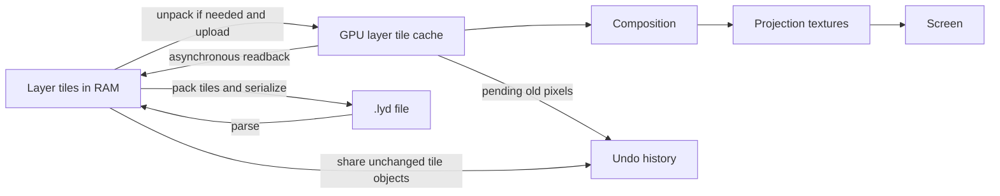
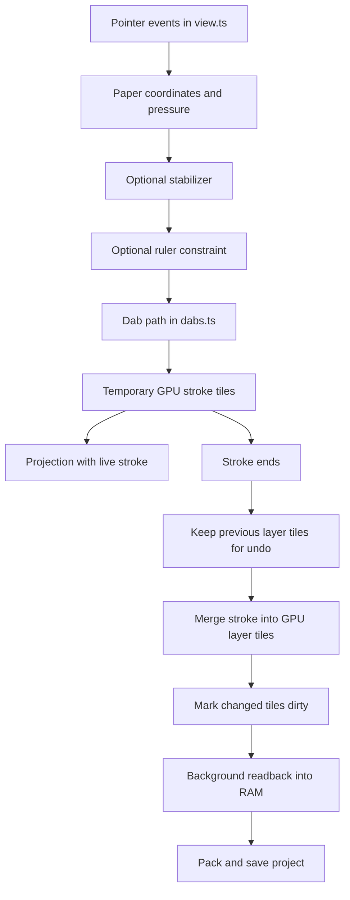

# How Lydia works inside

This is a map for a first contribution. It follows a stroke from input to pixels, then to a saved drawing.
It assumes you know TypeScript and React; the graphics terms are introduced along the way.
For tool instructions, read [the user guide](guide.md).

The code links below point to the implementation. The numbered decisions explain why it took this shape.
Read a decision's status as well as its title: some describe the prototype, a replaced design, or work still planned.
The measurements in them describe particular machines and experiments, rather than promises for every computer.

## A first route through the code

Start with these files, in this order:

1. [DrawSpace.tsx](../src/components/DrawSpace.tsx) creates the drawing engine inside a React component.
2. [engine.ts](../src/engine/engine.ts) connects the parts and exposes the operations the interface needs.
3. [view.ts](../src/engine/view.ts) turns pointer movements into actions in the drawing's coordinates.
4. [brush.ts](../src/engine/brush.ts) paints a stroke and commits it to a layer.
5. [projection.ts](../src/engine/projection.ts) prepares the picture shown on the screen.
6. [gpuTiles.ts](../src/engine/gpuTiles.ts) moves changed pixels back to RAM.
7. [projectFile.ts](../src/engine/projectFile.ts) reads and writes the project format.

You do not need to understand every shader before changing a toolbar.
For an engine change, follow the affected pixels through storage, undo, composition and saving before editing.
The same pixels can have several representations, and the newest one may temporarily exist only on the graphics card.

## The big picture: sparse layers and a prepared picture

Lydia is a raster drawing app: ordinary paint becomes pixels, rather than a permanent list of pen movements.
An earlier version stored strokes and replayed them; [decision 3](decisions.md#3-strokes-stored-as-data)
explains why that was replaced. Smudge and filters need to change existing pixels too.

The target is paper up to 10000×10000 pixels with 20 or more layers, from
[decision 9](decisions.md#9-performance-target).
A full layer at that size needs about 400 MB for its pixels alone: four bytes for each pixel.
Keeping many such layers on the graphics card would exhaust its memory.
Drawing all those layers on every frame also repeats work even when the picture has not changed.

Lydia divides each layer into square tiles of **256×256 pixels**.
Only tiles with paint need storage, so an almost empty large drawing does not allocate a full image per layer.
A tile key is a string such as `"3,2"`, meaning column 3, row 2.
See [tiles.ts](../src/engine/tiles.ts) and
[decision 5](decisions.md#5-raster-layers-made-of-tiles-drawn-with-pixijs).
That decision records that other tile sizes were not compared.

The CPU is the processor running JavaScript; RAM is the computer's main working memory.
The GPU is the graphics processor, with memory used for drawing.
WebGL 2 is the browser interface through which Lydia sends graphics work to that processor.
PixiJS manages much of the drawing machinery, including images, draw commands and render targets.

A **texture** is an image the graphics card can read while drawing.
A PixiJS `RenderTexture` is also an image it can draw into, without first sending the pixels back to JavaScript.
A **sprite** places a texture in a scene, with a position, size and other drawing properties.
A **shader** is a small program that runs on the graphics card, for example to calculate an output pixel's color.

Each layer owns a map of tiles in RAM.
The GPU keeps a cache of the layer tiles currently needed, rather than owning every layer permanently.
The screen normally draws the **projection**: another tile grid with the background and visible layers already combined.
Changing the view can therefore draw the prepared picture without recombining every layer.

This separation comes from
[decision 10](decisions.md#10-a-projection-the-screen-shows-one-picture-not-every-layer) and
[decision 11](decisions.md#11-layers-live-in-ram-the-graphics-card-is-a-cache).
The prototype's cache size in decision 11 is historical; the current engine receives a memory budget in GB
and converts it to a tile count with `tilesInGigabytes`.

Layer tiles are always whole squares, including at the edge of the paper.
They can also have negative coordinates or lie beyond the paper, so moving paint off the paper need not destroy it.
The projection, selections and normal brush strokes cover only the paper, with edge tiles cut to its dimensions.
This distinction matters because 10000 is not a multiple of 256.
See [decision 49](decisions.md#49-layers-off-the-paper).

## Where tiles live

There are three main places to look for the same drawing data:

The diagram leaves out temporary textures used for strokes, transforms and effects.
The projection and its composition caches also consume GPU memory, separately from the layer tile cache.
A layer-cache budget is therefore not a limit on every graphics allocation in the app.

### RAM is not always compressed

[memory.ts](../src/engine/memory.ts) defines `StoredTile`, which can hold:

- `color`: one packed RGBA value for an entire single-color tile;
- `pixels`: an unpacked byte array, ready to upload or inspect;
- `packed`: LZ4-compressed bytes.

A tile can hold both `pixels` and `packed`.
An entirely transparent tile is represented by absence from the layer's map.
The pixels of a stored tile are treated as immutable: edits replace the stored tile rather than changing its bytes.
That allows history and duplicated content to share old tile objects safely.

RGBA means red, green, blue and alpha, with alpha measuring opacity.
Lydia stores colors **premultiplied by alpha**: half-transparent red has its red value multiplied by one half.
This matches GPU composition; image export must convert back where required to avoid dark transparent edges.
The RAM arrays use rows from top to bottom.

Recently needed tiles stay unpacked while there is room.
When unpacked storage exceeds its budget, older tiles are compressed or lose their redundant unpacked copy.
This avoids repeatedly decompressing tiles while painting over detailed layers.
Read [decision 13](decisions.md#13-smaller-tiles-in-ram-single-colors-and-compression) together with
[decision 14](decisions.md#14-a-memory-budget-compress-only-when-ram-is-short).

[compressor.ts](../src/engine/compressor.ts) runs compression in Web Workers, background JavaScript workers
that do not run on the interface's main thread.
[lz4.ts](../src/engine/lz4.ts) implements the compression and decompression of LZ4 blocks.
Current unpacking in `memory.unpack` is synchronous; worker unpacking remains planned in decision 14.

The engine derives its unpacked RAM budget from roughly a quarter of the available RAM, with a minimum.
Browsers provide only a rough device-memory value; the desktop bridge can provide the real RAM size.
This budget controls unpacked tile storage, not the whole process's memory consumption.
Compressed bytes, temporary work and other app objects still take memory.

### The GPU copy can be newer

[gpuTiles.ts](../src/engine/gpuTiles.ts) identifies cache entries by layer ID and tile key.
`getTexture` finds or uploads a tile, and can create an empty tile when a tool needs somewhere to paint.
Cache use updates its order, so the least recently used clean tiles are candidates to leave first.

A tile becomes **dirty** when its GPU pixels are newer than its RAM pixels.
Dirty tiles cannot be evicted before readback, and do not count toward the clean-cache budget.
This is essential for large brushes: otherwise the cache could discard paint just produced by the same stroke.
See [decision 15](decisions.md#15-painted-tiles-stay-on-the-graphics-card-until-they-are-saved).

Readback uses WebGL 2 pixel buffers and fences.
A pixel buffer receives GPU output; a fence lets JavaScript check whether the GPU has finished that work.
Lydia can start a read, return to other work, and collect its result on a later frame.
This avoids a synchronous GPU read in the painting path, as explained in
[decision 12](decisions.md#12-reading-pixels-back-without-waiting).

Cache entries carry a version number.
If a tile changes again while a read is in flight, the old read must not replace newer paint in RAM.
Look at read completion and version checks when investigating a drawing that loses recent changes.

The engine's `backgroundWork` advances readback and projection work on PixiJS's frame ticker.
It does less work while a stroke is active and skips saving tiles history is still recording.
It also checks the RAM budget periodically when not painting.
“Saved to RAM” here means safe from GPU-cache eviction; it does not mean written to a project file.

## The life of a brush stroke

This is the ordinary brush and eraser path.
Smudge, blur and liquify share the input route but change pixels differently, described later.

### 1. Input reaches the view

[view.ts](../src/engine/view.ts) attaches pointer listeners to the engine's canvas.
Pointer capture keeps receiving the drag when the pointer leaves that canvas.
The view chooses a gesture according to the tool, modifier keys and current editing state.
Panning, turning and zooming the view are gestures too; they do not paint pixels.

Pointer positions arrive in screen coordinates.
The view converts them to paper coordinates through the drawing container's transform,
so drawing still lands in the right place after zooming, rotation or mirroring.
Brush sizes and dab positions are expressed in paper pixels, independently of screen zoom.

The view also reads pen pressure and collects coalesced pointer events when the browser supplies them.
Coalesced events are intermediate input samples grouped into one event delivery.
Using them preserves more of a fast movement than using only its last position.
The resulting `StrokePoint` contains `x`, `y` and `pressure`.

### 2. Stabilization and rulers shape the path

[stabilizer.ts](../src/engine/stabilizer.ts) optionally filters those points.
Smooth mode makes the brush chase the pen; String mode pulls it only when the pen moves beyond a string length.
The view advances a waiting stabilizer on frames too, so Smooth can catch up while the pen is held still.
See [decision 46](decisions.md#46-the-stabilizer).

[rulers.ts](../src/engine/rulers.ts) then constrains the stabilized path to a line, ellipse or vanishing point.
Applying rulers after stabilization prevents the stabilizer from cutting across an ellipse's curve.
With several rulers, initial movement helps choose the one whose direction fits.
See [decision 78](decisions.md#78-rulers).

On a normal pointer release, the view finishes the stabilizer and ruler path before ending the stroke.
A cancelled pointer ends where the brush has reached instead.
When the pointer hovers without painting, the view also prepares nearby tiles a few at a time.
That reduces the work at the first dab: [decision 16](decisions.md#16-tiles-under-the-brush-are-made-ready-before-the-stroke).

### 3. The path becomes dabs

A **dab** is one impression of the brush tip.
[dabs.ts](../src/engine/dabs.ts) places dabs along the path at the brush's spacing,
rather than painting one impression per browser event.
It calculates size, angle, alpha, pressure and random seed for each dab.

This is where pressure-dependent size and flow, taper and pixel placement affect the stroke.
Pixel brushes use whole-pixel rules instead of freely positioned smooth tips.
The brush also handles pixel-perfect corner removal, including restoring a latest dab that should be left out.
Straight-line helpers live in [straightLine.ts](../src/engine/straightLine.ts).

[brush.ts](../src/engine/brush.ts) expands dabs through
[symmetry.ts](../src/engine/symmetry.ts) and groups them by the tiles they touch.
A dab crossing a tile boundary is painted into each touched tile with an appropriate coordinate offset.
Its reach, rather than only its center, determines whether it touches the paper.

### 4. Dabs paint temporary stroke tiles

[dabPainter.ts](../src/engine/dabPainter.ts) draws the impressions into GPU textures.
Smooth tips use the tip's image; pixel tips follow whole-pixel rules; noisy tips use
[noiseDabs.ts](../src/engine/noiseDabs.ts).
The brush preview uses this painter too, keeping preview and drawing behavior aligned.

The normal brush first paints into its own temporary tiles, white with paint coverage in alpha.
It does not immediately change the layer's persistent pixels for every dab.
The projection shows this temporary stroke with its color, blend mode and whole-stroke opacity.
See [decision 36](decisions.md#36-strokes-are-painted-in-tiles-of-their-own).

This separates dab flow from stroke opacity.
Repeated impressions can build coverage according to the brush, while the finished stroke still respects its opacity.
A washing brush keeps the greatest contribution rather than accumulating every overlap.

For grain, [grain.ts](../src/engine/grain.ts) combines the stroke coverage with pressure and a repeated paper-height image.
The grain stays attached to the paper, so returning to a position finds the same grooves.
The selection cuts the result to the permitted area; raw temporary tiles keep that cut from accumulating repeatedly.
See [decision 67](decisions.md#67-the-paper-grain).

### 5. Undo keeps the previous layer pixels

Before `mergeStroke` changes each layer tile, it calls `history.backUpTile`.
The history keeps that tile's previous state once for the recorded change, including `null` for a previously empty tile.
An immutable tile already in RAM can be shared, without copying all its bytes.

If its newest pixels are still on the GPU, history keeps a pending read instead.
The GPU helpers also support using pending pixels without first bringing them through RAM.
Read [history.ts](../src/engine/history.ts), [gpuTiles.ts](../src/engine/gpuTiles.ts),
[decision 8](decisions.md#8-undo-and-redo-by-swapping-tiles) and
[decision 17](decisions.md#17-undo-never-waits-for-the-graphics-card).

Undo swaps the saved state with the current one; redo swaps it back.
History also records layer properties, order, selections and grouped operations.
Its budget is based on memory, rather than a fixed count of strokes, and empty tile changes do not create useful steps.
Large strokes therefore cost more history than small ones.

### 6. The stroke becomes layer paint

At stroke end, the brush merges the temporary textures into the active layer's cached GPU tiles.
An eraser removes coverage; transparency lock preserves the layer's existing alpha.
A non-normal brush blend mode uses the composition helpers to mix with the layer's existing paint.
Each changed tile is marked dirty for later readback.

The projection has already been updated while the stroke was visible.
The ordinary stroke's merge therefore commits the pixels behind that picture rather than making a new picture appear.
Temporary textures are recycled or released, and the history recording finishes.
The engine notifies subscribers when the completed operation changes its state.

### 7. Changed pixels return to RAM

The frame ticker starts and collects asynchronous reads through `gpuTiles.ts`.
Finished reads become `StoredTile` objects in the layer's map.
Uniform tiles can collapse to a color, and transparent tiles can disappear from storage.
Once a cached tile is clean, normal cache trimming can remove its GPU copy.

The RAM budget may later compress it.
A future composition or stroke uploads it again, unpacking it first if necessary.
Readback, compression and writing a `.lyd` file are separate stages with different triggers.

## How the projection is composed

[projection.ts](../src/engine/projection.ts) owns the projection textures, their sprites and a cache called `below`.
`below` contains the paper and the layers below the active portion of the stack.
While painting, recomposition can start from it and add the changing layer and what is above it.
Inside folders, the split respects the folder boundary rather than blindly stopping at the active layer.

Selecting a different layer does not itself change the drawing's appearance.
The engine can leave the projection alone and mark `below` stale, rebuilding individual tiles only when needed.
This avoids recomposing an entire large drawing simply because the user selected another layer.

[composer.ts](../src/engine/composer.ts) walks the layer structure at a tile position.
It deals with folder isolation or pass-through, clipping and the steps needed for live changes.
Read it when a combination of layers is wrong, rather than starting with pointer handling.

[blendModes.ts](../src/engine/blendModes.ts) provides the GPU operations and formulas used to combine colors.
Many modes need both the foreground and the existing background pixel, beyond what fixed GPU blending can express.
The module supplies shaders and drawing helpers for those cases.
See [decision 56](decisions.md#56-blend-modes).

Layer visibility, order or opacity can affect many projection tiles.
The projection queues work and can prepare replacements out of sight before showing them together.
Live opacity and move previews have special paths so dragging does not require rebuilding the entire drawing each time.
See [decision 26](decisions.md#26-big-layer-changes-are-prepared-in-the-background) and the later live-preview decisions.

The projection is the flattened paper image, not every visible item in the canvas.
Selections, rulers, transform handles, cursor outlines and the optional off-paper view are additional display content.
They help edit the drawing without becoming paint in the saved layer tiles.

## Module map for tools and drawing data

The central storage and composition modules are described above.
The following groups locate the remaining tool logic; engine operations connect them to history and the interface.

### Layers and editing state

- [layers.ts](../src/engine/layers.ts) defines layers, their tile maps and properties, the active stack,
  and helpers for folders, visibility and clipping relationships.
- [history.ts](../src/engine/history.ts) records reversible changes and retains the old data needed to swap them back.
  A new pixel-changing operation must participate in this path, not only change what the screen shows.
- [selection.ts](../src/engine/selection.ts) represents selection coverage by tile and implements polygon and region
  selections, combination, inversion and cutting paint; `null` means tools are unrestricted by a selection.
- [selectionView.ts](../src/engine/selectionView.ts) draws selection feedback and supplies GPU masks to tools.
  A selection's stored coverage and its marching-ants display serve different purposes.

### Brush resources

- [brush.ts](../src/engine/brush.ts) owns the ordinary brush stroke, temporary tiles and final merge into the layer.
  Follow it for stroke opacity, selection cutting, grain, symmetry and dirty-tile marking.
- [dabs.ts](../src/engine/dabs.ts) turns a path into spaced tip impressions, including pressure and taper rules.
  It is the starting point for changes to how impressions are distributed along a stroke.
- [dabPainter.ts](../src/engine/dabPainter.ts) draws those impressions into a target texture.
  It is shared with previews rather than reimplementing the brush in React.
- [brushTip.ts](../src/engine/brushTip.ts) reads tip and grain images into usable canvases and derives paint coverage.
  A ready tip is white with the amount of paint in alpha, so a stroke can tint it any color.
- [grain.ts](../src/engine/grain.ts) applies the paper-height pattern through a GPU pass using stroke pressure.
  It treats grain across a stroke rather than independently wearing down each overlapping dab.
- [brushFile.ts](../src/engine/brushFile.ts) defines and validates `.lydbrush` files and brush settings.
  Look here for file defaults and limits before adding a brush parameter.

### Pixel operations and moving paint

- [fill.ts](../src/engine/fill.ts) finds a color region and calculates filled tile pixels in RAM, yielding during long
  work; its reference can be the active layer or the visible composition without paper.
- [move.ts](../src/engine/move.ts) calculates whole-pixel moves from the original layer tiles and shifts the selection.
  It retains paint moved off the paper while keeping the selection itself on the paper.
- [smartObject.ts](../src/engine/smartObject.ts) keeps original source tiles and a placement, then renders from that
  source for transforms; repeated scaling and turning therefore do not repeatedly resample the last result.
- [warp.ts](../src/engine/warp.ts) describes a grid of control points and the curved surface between them.
  Smart-object rendering uses that surface together with the object's corner placement.
- [liquify.ts](../src/engine/liquify.ts) keeps a source and a displacement map while a liquify session remains valid.
  Strokes change where source pixels are sampled, allowing Reconstruct to return toward the original pixels.
- [mixTools.ts](../src/engine/mixTools.ts) implements smudge and local blur through the chosen brush tip.
  These dabs depend on earlier dabs' paint, so they use work tiles rather than the ordinary brush's final-only merge.
- [tileWriter.ts](../src/engine/tileWriter.ts) provides shared tile-writing support for operations such as filters.
  Read it alongside the calling tool to follow selection and transparency-lock handling.

Smart objects cannot be painted on until converted to ordinary pixels.
Their layer tiles hold a rendered result, while their separate source preserves the information needed for another transform.
See [decision 42](decisions.md#42-smart-objects-and-transforming) and
[decision 72](decisions.md#72-the-mesh-of-a-transform).

### Editable content and effects

- [shapes.ts](../src/engine/shapes.ts) defines editable shape geometry, style and placements, including curves.
  [shapePainter.ts](../src/engine/shapePainter.ts) renders the resulting fill and brush outline into tiles.
- [curves.ts](../src/engine/curves.ts) defines points with handles and converts cubic Bézier segments into a path.
  [curveTool.ts](../src/engine/curveTool.ts) manages interactive creation and editing of those points.
- [text.ts](../src/engine/text.ts) lays out words and produces source tiles for text smart objects.
  Keeping both words and rendered source allows editing and sharp rerendering while preserving display without the font.
- [filters.ts](../src/engine/filters.ts) implements hue/saturation, levels and Gaussian blur with preview, apply and cancel.
  Preview leaves the RAM source unchanged; applying calculates the committed tiles as one history operation.

Shapes and curves keep editable descriptions as well as their rendered pixels.
They are not a return to storing every freehand stroke as vectors.
Text similarly adds editable words to a smart object.
The reasons and limits are in [decision 79](decisions.md#79-shapes),
[decision 80](decisions.md#80-filters), [decision 81](decisions.md#81-text) and
[decision 89](decisions.md#89-curves).

## React and the engine

[DrawSpace.tsx](../src/components/DrawSpace.tsx) gives `createEngine` a host element, project data and GPU budget.
The engine creates the PixiJS application, checks for WebGL 2 and attaches its canvas to that host.
Creation is asynchronous, so the component also handles unmounting before the engine is ready.
Cleanup calls `destroy`, releasing the engine's listeners and resources.

[engine.ts](../src/engine/engine.ts) is the interface's main entry point.
It constructs the stack, memory manager, GPU cache, projection, history, tools and view,
then exposes methods such as `setBrush`, `addLayer`, `undo`, `startTransform` and `saveProject`.
It also coordinates long operations and decides when the drawing is busy or modified.

The interface reads an `EngineSnapshot`, containing layer summaries, undo availability,
selection presence, current editing state, task progress and other control state.
`getSnapshot` returns the current snapshot; `subscribe` registers for changes.
The engine replaces the snapshot and notifies listeners through its change path.

[engineHooks.ts](../src/components/engineHooks.ts) connects that contract to React with `useSyncExternalStore`.
`useEngineSnapshot` supplies the main snapshot, and `useViewState` subscribes separately to zoom, rotation and flip.
Keeping view updates separate avoids updating unrelated controls for every zoom movement.
The same file connects shortcuts, remembered settings and autosave to engine methods.

The direction is `screens` → `components` → `engine`.
**Nothing in `src/engine/` imports React.**
A tool works with ordinary data and engine collaborators; React renders the surrounding controls.
Pointer samples and GPU textures do not need to travel through React state to paint a frame.

## From RAM to a project file

`engine.saveProject` first waits for dirty GPU tiles to reach RAM.
It collects layer properties and tiles, including smart-object sources, and packs nonuniform tile data.
It then calls `serializeProject` in [projectFile.ts](../src/engine/projectFile.ts).
The returned file contains the drawing's layers, rather than only the screen's flattened projection.

The binary file starts with `LYDIAPRJ`, then a four-byte header length, then a JSON header.
Compressed tile blocks follow the header; tile entries give their offsets and lengths.
Single-color tiles store their color in the header and need no pixel block.
The header also carries project size, background, DPI, layer structure and supported editable data.

The writer selects a compatible format version according to the data needed.
Projects without off-paper content can use version 2, or version 3 for smart objects.
Version 4 supports whole tiles beyond the paper, including negative tile coordinates.
Opening validates the header and tile entries, and adapts older edge tiles to the current whole-tile representation.

Older supported files may lack newer fields; readers provide defaults or omit unsupported editable metadata safely.
The original stroke-based version 1 is deliberately rejected, as recorded in
[decision 21](decisions.md#21-a-new-project-file-without-opening-the-old-one).
Do not interpret that historical break as permission to break current supported files.
Compatibility fixtures live in [tests/app/files](../tests/app/files).

The surrounding interface chooses where the file goes.
[files.ts](../src/files.ts) provides browser downloads; [desktop.ts](../src/desktop.ts) provides desktop file transport.
Image export is a separate engine operation: it flattens the picture to PNG or JPEG rather than preserving layers.
Saving a project and exporting an image are therefore different paths to inspect.

Autosave is separate again: [autosave.ts](../src/autosave.ts) keeps recoverable drawing snapshots in IndexedDB,
the browser's local database, rather than repeatedly downloading `.lyd` files.
`quietSnapshot` waits for an appropriate settled engine state, and the autosaver can reuse unchanged tile data.
See [decision 75](decisions.md#75-autosave-and-recovering-a-drawing).

## What Electron adds

The desktop app runs the same built React pages and engine inside an Electron window.
It adds system file access, persistent brush and tray folders, file opening from the operating system,
window controls, interface scaling, memory information and update handling.
The design is recorded in [decision 87](decisions.md#87-the-desktop-app).

- [main.mjs](../electron/main.mjs) starts the window and serves packaged pages at `app://lydia/`.
  Development can load Vite through `LYDIA_DEV_URL`; a packaged app ignores that variable.
- [preload.cjs](../electron/preload.cjs) exposes a limited `window.lydiaDesktop` bridge.
  The page requests supported operations through messages instead of importing Node's filesystem directly.
- [files.mjs](../electron/files.mjs) manages allowed file paths and the `Documents/Lydia` folders:
  `Projects`, `Exports`, `Brushes` and `Tray`.
- [updates.mjs](../electron/updates.mjs) checks releases and reports update availability to the page.
  Windows downloads updates for installation on closing; macOS directs the user to the download page.
- [memory.mjs](../electron/memory.mjs) reads real RAM and attempts to identify graphics memory on Windows.
  [settings.ts](../src/settings.ts) uses desktop information when choosing automatic budgets, with fallbacks.

[desktop.ts](../src/desktop.ts) gives the renderer typed access to that bridge; it is absent in a browser.
Project writes cross the bridge in chunks, go to a `.saving` file and replace the destination only after completion.
This protects the previous saved file if writing fails partway through.
The close path also allows the usual question about unsaved work before an immediate update restart.

Desktop autosave remains in the local database rather than those visible folders.
The Electron window disables background frame throttling because engine settling and autosave depend on frames.
A hidden browser tab can still be throttled by the browser.
Read the desktop decision before changing lifecycle behavior that appears unrelated to drawing.

## Tests and a first investigation

[tests/app](../tests/app) contains tests that start Vite and drive Chrome through Puppeteer.
For example, [stabilizer.mjs](../tests/app/stabilizer.mjs) opens a drawing, sends input and inspects the result.
Tests combine interface interactions with checks of pixels, layer data, undo and saved files.
The desktop test instead opens the built pages in Electron.

In development, `DrawSpace` exposes `window.lydia` with the engine and the parts returned by `inspect()`.
Tests use it to locate paper coordinates, inspect state and wait for engine work.
It is a development inspection entry point, not a separate production API.
Do not confuse it with `window.lydiaDesktop`, the desktop bridge.

Run the suite with `npm run test:app`.
For one test in Git Bash, use `LYDIA_TEST_PORT=5199 node tests/app/stabilizer.mjs`.
The ports 5198–5201 keep tests away from the usual development server.
Read [the test guide](../tests/app/README.md) for setup, output, timing checks and how to add one.

For a first bug investigation, choose a small drawing and the nearest feature test.
Check whether the incorrect result exists in layer RAM, only in a dirty GPU tile, or only in the projection.
Then check whether undo and saving preserve it: those observations narrow the responsible part of the pipeline.
Look at generated screenshots as well as assertions, since correct state alone does not prove the display is right.

## Where to go next

- [decisions.md](decisions.md) records one numbered decision per feature, including alternatives and what was checked.
  Its first person is Enrico's voice; it is the place to look before proposing a different behavior or architecture.
- [spike-notes.md](spike-notes.md) contains prototype measurements behind the engine's foundation.
  Use it to understand the experiments, while checking the current code for what actually shipped.
- [errors.md](errors.md) explains the `LYD-NNN` error codes, paired with [errors.ts](../src/errors.ts).
  Follow that system when an operation needs a new reported failure.
- [ROADMAP.md](../ROADMAP.md) lists remaining work; an item there is not proof of an implementation.
  In particular, [decision 18](decisions.md#18-reading-tiles-back-in-batches) is still marked planned.
- [CONTRIBUTING.md](../CONTRIBUTING.md) gives the contribution workflow and required checks.
  [AGENTS.md](../AGENTS.md) adds the rules for automated contributors.

For a control change, begin at its React component and the engine method it calls.
For paint behavior, begin at `view.ts`, `brush.ts` and the relevant tool.
For missing or stale pixels, follow `gpuTiles.ts`, `history.ts` and `projection.ts` together.
For files, start at `projectFile.ts`, then follow the browser or desktop transport.
